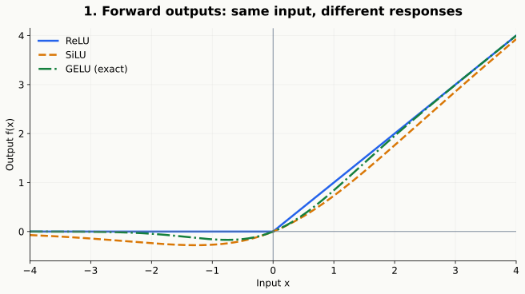
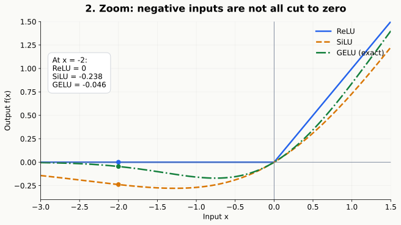
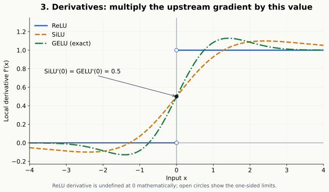

{
  "title": "激活函数：为什么需要 ReLU、GELU 和 SiLU？",
  "description": "第三章 · 第 2 篇。从距离函数理解非线性的必要性，结合三张 Python 对比图，区分激活输出、局部导数与梯度传递。",
  "date": "2026-11-11T16:05:26+08:00",
  "slug": "activation-functions",
  "categories": ["基础"],
  "tags": ["激活函数", "ReLU", "GELU", "SiLU"],
  "draft": false
}

[上一节]()讲了 Linear 怎样组合特征。但为什么组合之后还需要非线性？讨论中，我们从一个它无法表达的任务开始，再用曲线比较三种激活函数。

## 1. 非线性解决的是表达限制

假设输入 x 是位置，目标是输出到原点的距离：

| x | 希望的输出 |
| ---: | ---: |
| −1 | 1 |
| 0 | 0 |
| 1 | 1 |

模型 y=wx+b 要满足 x=0 时输出 0，就必须 b=0；满足 x=1 时输出 1，又要求 w=1。但此时 x=−1 的输出为 −1，不是 1。

**不存在一组 w、b 能满足这三条要求。** 不是训练不够久，而是模型本身表达不了。

距离函数在 x＜0 时，输入增大、距离减小；在 x＞0 时，输入增大、距离增大。它需要不同区域有不同响应，而 Linear 的斜率固定。

纯粹多堆几层也不行：

```text
h=2x+1，y=3h−2
合并后：y=6x+1
```

要打破这种可合并关系，需要非线性。例如：

```text
h₁=ReLU(x)，h₂=ReLU(−x)
y=h₁+h₂=|x|
```

ReLU 的规则是 max(0,x)。x=−3 时，两个单元分别输出 0、3，相加正好得到距离 3。**简单单元在不同区域给出不同响应，组合起来就能突破纯线性的限制。**

## 2. 先看输出曲线，再比较平滑方式

下面三张图颜色一致：蓝色 ReLU，橙色 SiLU，绿色 GELU。横轴始终是输入 x。



图右侧，大的正输入逐渐接近原样通过；图左侧，ReLU 全部归零，SiLU、GELU 留下被缩小的负值。原点附近，ReLU 有折角，另外两条平滑过渡。

### SiLU：输入乘 sigmoid

```text
SiLU(x)=x×sigmoid(x)
sigmoid(x)=1/(1+e^(−x))
```

sigmoid 在 0 与 1 之间，可理解为保留输入的比例。x 很正时比例趋近 1，很负时趋近 0。

### GELU：换一种平滑权重

```text
GELU(x)=x×Φ(x)
```

Φ 是标准正态分布的累积分布函数，随 x 增大，从接近 0 上升到接近 1。它不是每次随机决定保留或丢弃：**同一输入按公式得到同一结果。**

| x | ReLU | SiLU，约值 | GELU，约值 |
| ---: | ---: | ---: | ---: |
| −2 | 0 | −0.238 | −0.046 |
| 0 | 0 | 0 | 0 |
| 2 | 2 | 1.762 | 1.954 |

虽然 sigmoid(0)=Φ(0)=0.5，乘上输入 0，输出仍是 0。



放大后能看到小凹谷：从很负的输入向右移动，SiLU、GELU 的输出先变得更负，再回升到 0。**它们并不是处处单调递增。**

## 3. 输出高度不是导数，斜率才决定反向传递

反向传播遵循：

```text
传给输入的导数 = 上游导数 × 当前激活函数的局部导数
```

下面纵轴换成了导数，不再是输出值。前两张图里的高度，与这张图里的高度，含义不同。



### ReLU：正区间通过，负区间为零

```text
x>0：输出 x，导数为 1
x<0：输出 0，导数为 0
```

输入为 −3，即使上游导数是 100，传回仍是 0。这不是 detach：图可以正常记录，只是当前位置局部导数为零。

**x=0 怎么办？** 左斜率为 0、右斜率为 1，数学上没有普通导数。实际反向需要选定约定，PyTorch 使用 0。图中两个空心点表示单侧极限，不表示数学上在原点有两个导数。

### SiLU：输出为零，仍可传梯度

记 s=sigmoid(x)，利用 s′=s(1−s)，对乘积求导：

```text
SiLU′(x)=s+x×s(1−s)
SiLU′(0)=0.5
```

因此输入为 0 时，虽然输出为 0，上游导数若为 2，传回的导数仍为 1。**不能看到输出为零，就断定梯度为零。** GELU 在 0 处的导数也为 0.5。

### 平滑也不保证梯度始终强

在 x=−2，SiLU 的导数约为：

```text
0.119+(−2)×0.119×(1−0.119)≈−0.091
```

上游导数为 2，则传回约 −0.182。负导数不是错误：对应凹谷左侧“输入增加，输出下降”的区域。

SiLU、GELU 没有把整个负区间的导数设成零，但导数可能很小、可能为负，也会在某个位置为零。输入非常负时，导数逐渐趋近 0。**输出的正负，不能单独决定斜率的正负。**

## 4. ReLU 失活，指的是更持续的情况

考虑一个单元：

```text
z=wx+b，h=ReLU(z)
```

若当前 w=0、b=−1，所有样本的 z 都为 −1、h 都为 0。反向时：

```text
∂L/∂z=上游导数×0=0
∂L/∂w=(∂L/∂z)×x=0
∂L/∂b=∂L/∂z=0
```

在这个简单例子中，只靠数据梯度做普通 SGD，参数不变，下次仍然输出零。这是单元失活的一种情况。

但某条样本输出 0 很正常，不能据此判定失活。若另一条样本让 z＞0，且上游梯度非零，就仍可能贡献参数梯度；具体还取决于输入与连接。其他层的变化、优化器历史状态也可能改变处境，不能把一次零梯度理解为永远无法恢复。

## 5. 激活逐元素计算，Linear 才负责混合特征

例如：

```text
输入：[[−2,0,2],
       [ 3,−1,1]]

ReLU：[[0,0,2],
       [3,0,1]]
```

shape 仍是 (2,3)。SiLU、GELU 也逐元素处理，不会把特征相加；输入 (8,20,128)，输出仍是 (8,20,128)。

```text
Linear：加权组合不同输入特征
激活：对每个组合结果分别做非线性变换
```

反向时，上游梯度与对应位置的局部导数逐元素相乘，不是矩阵乘法。标准 ReLU、SiLU、GELU 本身没有可学习参数，训练调整的是前后层的参数，而非这些固定公式。

## 6. 没有仅凭曲线就能确定的最佳选择

| 函数 | 前向特点 | 反向特点 |
| --- | --- | --- |
| ReLU | 负值归零，正值保留 | 负区间 0，正区间 1 |
| SiLU | x 乘 sigmoid，平滑缩放 | 负区间可传梯度，局部导数平滑变化 |
| GELU | x 乘正态累积分布函数 | 与 SiLU 类似，但具体曲线不同 |

平滑、能保留负值，不保证一定训练更好；ReLU 简单，也不等于表达能力弱。结果还取决于结构、初始化、优化设置与任务。

图使用精确 GELU 公式生成，导数数值已核对。可下载 [Python 绘图脚本](plot_activations.py)复现本页三张图。本文只记录已经讨论的内容，不展开新的激活变体。

## 小结与自检

**非线性让响应随输入区域改变；前向看输出，反向看斜率。** Linear 与激活组合，才能突破纯线性堆叠的表达限制。

1. y=wx+b 无法同时满足距离例子的三条要求，是优化器问题吗？**答：不是，是表达限制。**
2. ReLU 在 0 处反向用 0，是唯一的数学导数吗？**答：不是，是实现约定，那里没有普通导数。**
3. 输出为负，导数一定为负吗？**答：不一定，输出高度与曲线斜率是两回事。**
4. 把 ReLU 换成 GELU 能保证预测更准吗？**答：不能，需要结合模型和任务验证。**
